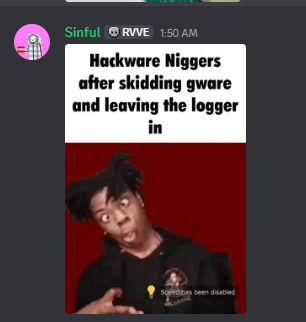
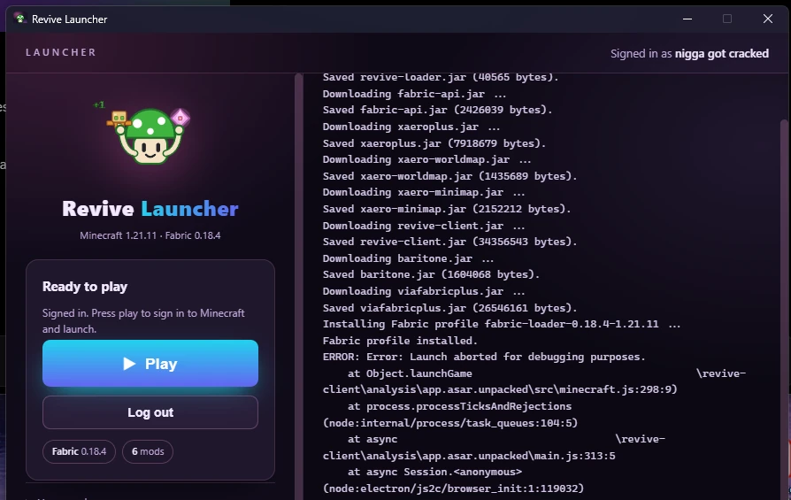
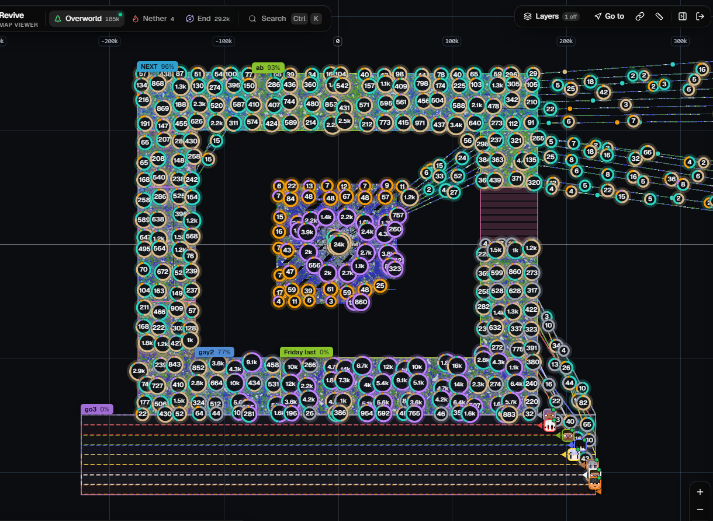

# Revive Client

## What this repo is

A full forensic teardown of the **Revive** client, launcher, loader, and website, because "Revive
Development" shipped a client that is:
1. a skid of someone else's work,
2. broken, and
3. free bait for ratting the people who install it.

The full teardown is organized as follows:
- [**01. Source Reconstruction**](01.%20Source%20Reconstruction), basically all their source code, reconstructed from the shipped artifacts.
- [**02. Teardown Analysis**](02.%20Teardown%20Analysis), the write-ups and the receipts documenting the issues with the client, launcher, loader, website, and infrastructure.
- [**03. Patched Reconstruction**](03.%20Patched%20Reconstruction), the reconstructed source code with the logging patched out.
- [**04. Tools**](04.%20Tools), the utilities and scripts used during the teardown and analysis.
- [**05. Configs**](05.%20Configs), the configuration files used by the client.

## In plain terms

These guys lifted an actual client, filed the serial numbers off badly, and are handing it out
**free**, not out of generosity. The client is the bait. Per an insider recording of them
screensharing their own source, the plan is to build trust and a userbase on a working-looking free
client and then **push a RAT to their own users** through it.

<audio controls src=".github/static/qL91XPiNBYw8SccPve6JlQ.mp3"></audio>
 
the insider recording (<a href=".github/static/qL91XPiNBYw8SccPve6JlQ.mp3">play / download</a>)
 
 

The irony here is these retards love to project that Hackware is a logger (its not), yet they are skidding Hackware themselves, and actually adding a logger. Then they got all mad when one of their members got caught using another client (Hachimi) at their stash, thinking that was what was coord logging them. 😭😭😭

